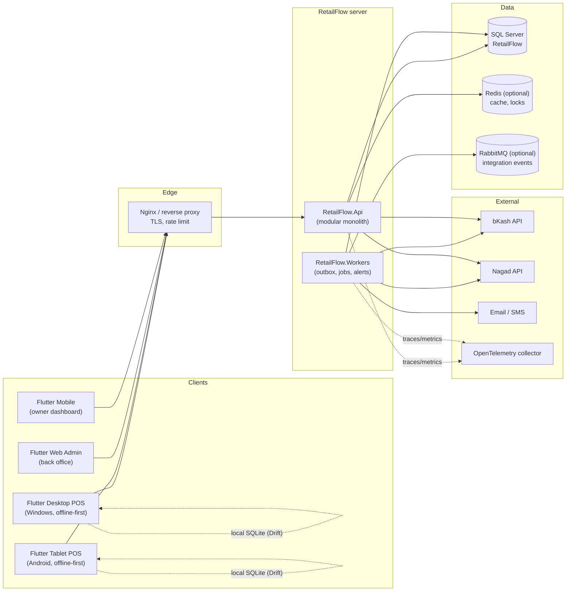
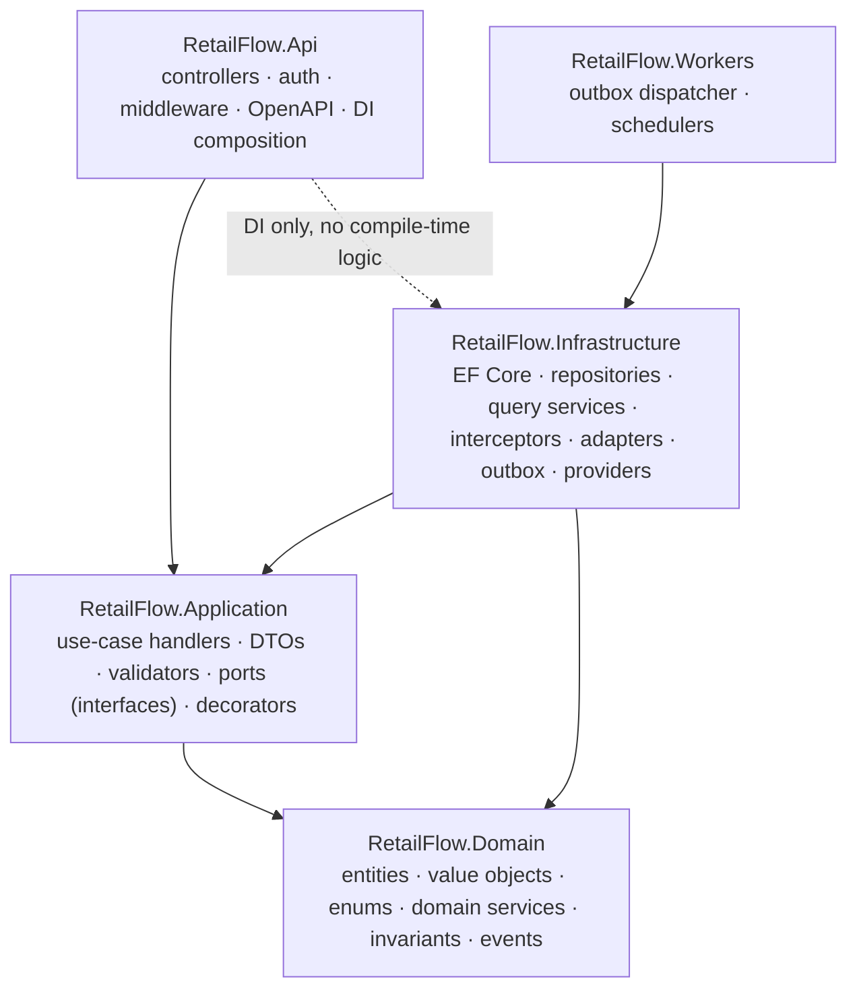
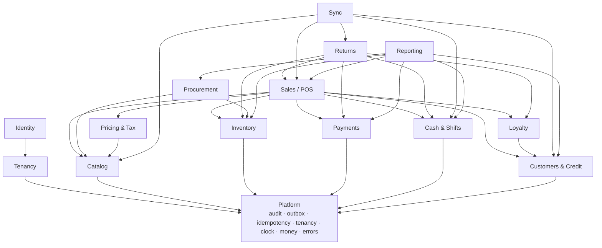
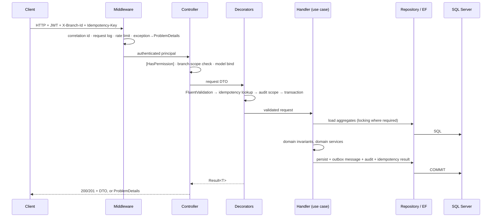
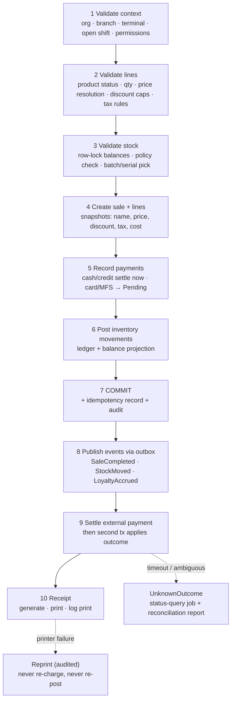
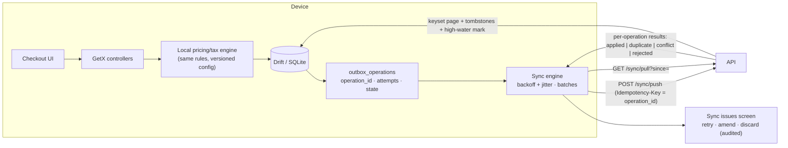
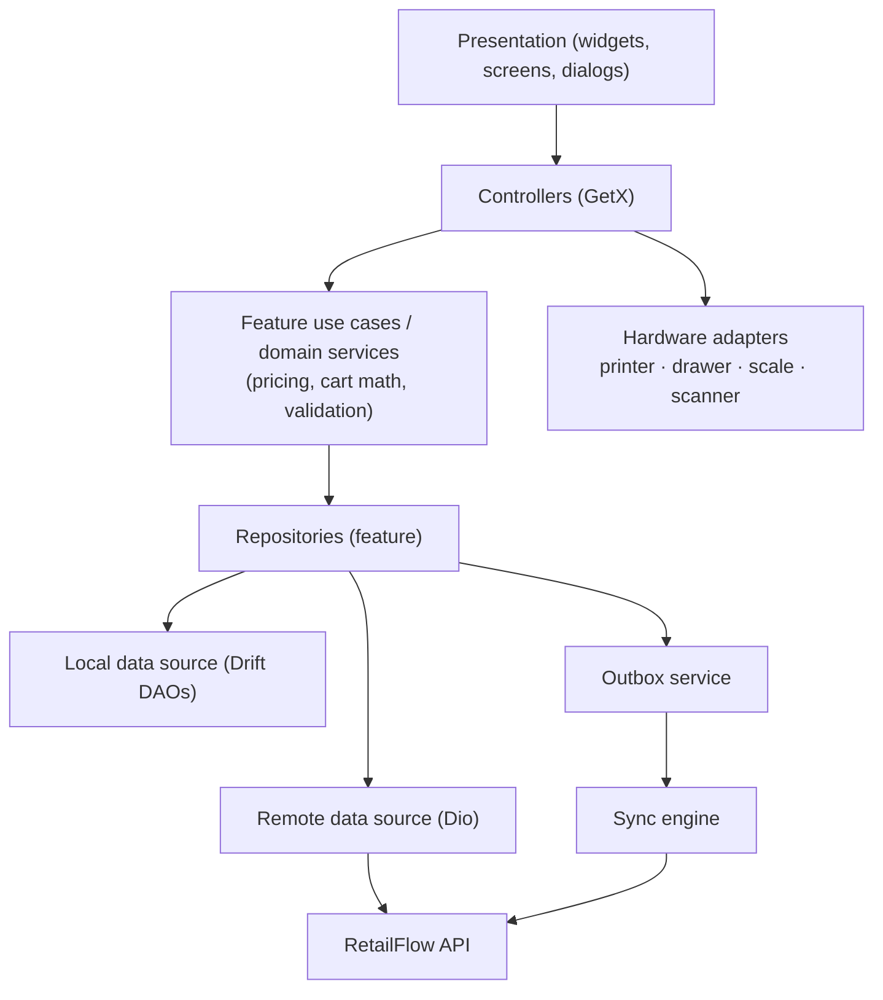
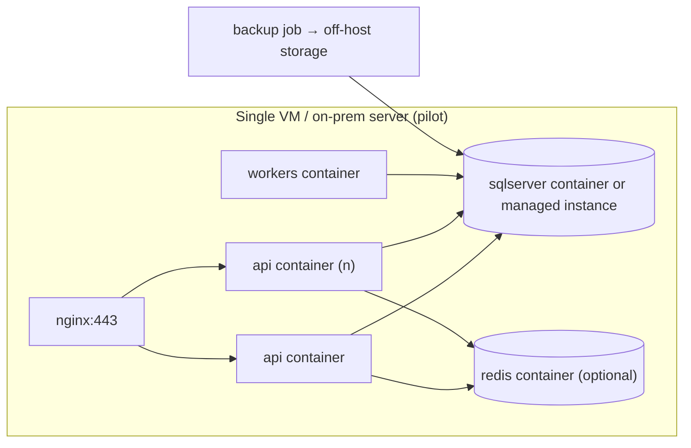

# 03 — Architecture

RetailFlow POS · v0.1 · 2026-10-11 · decisions are justified in `../decisions.md`

---

## 1. System context

Device-side payment provider calls are **not** made from the terminal; the terminal asks the API,
which owns provider credentials. Offline therefore means cash/credit only (FR-OFF-08).

## 2. Layers

Rules (ADR-0002):

- `Domain` has **zero** external dependencies — no EF Core, no ASP.NET, no DTOs.
- `Application` defines ports (`ISaleRepository`, `IStockLedger`, `IPaymentProvider`, `IClock`, …)
  and never references EF Core.
- `Infrastructure` is the only place with `DbContext`, SQL, HTTP clients and file I/O.
- `Api` wires everything and translates HTTP ↔ use cases. It contains no business rule.
- Phase 17 adds architecture tests that fail the build on a forbidden reference.

## 3. Modules

Each module owns its tables. A module reads another module's data only through that module's
Application contract (e.g. Sales asks Pricing for a quote, asks Inventory to post movements).
`Reporting` is the sole exception: it owns read-only projections/queries that may span modules,
because reports inherently cross boundaries.

## 4. Request pipeline

Decorator order is fixed and explicit, outermost first: `Logging → Validation → Idempotency or
Transaction → Handler`. Idempotency and the transaction are **one** decorator, because the stored
response has to commit atomically with the business change and two independent decorators cannot
guarantee that (ADR-0025). It looks the key up before opening the transaction, then reserves it,
runs the handler and stores the response inside it. A request that is retryable implements
`IIdempotentRequest`; one that merely writes implements `ITransactionalRequest`; a read-only query
implements neither and gets no transaction. Audit rows are written by the handler through
`IAuditWriter` on the same context, so they commit with the change.

## 5. Transaction boundaries

| Operation | One DB transaction covers | Explicitly outside |
|---|---|---|
| **Any idempotent operation** | idempotency reservation + the handler's work + the stored response snapshot + outbox messages + audit rows + sync-cursor allocation (ADR-0025) | the key lookup that precedes it |
| **Create sale** | sale + lines + line taxes + discounts + stock movements + balance updates + reservations release + cash/credit payments + loyalty accrual + customer ledger + numbering allocation + outbox messages + idempotency record | provider payment calls, printing, email/SMS, report refresh |
| **Card/MFS payment** | tx1: payment row `Pending`; tx2: outcome applied (`Completed`/`Failed`/`UnknownOutcome`) + sale state + cash/loyalty effects | the provider HTTP call between tx1 and tx2 |
| **Provider callback** | verify + payment state transition + sale settle + outbox | nothing |
| **Return** | return + lines + refund(s) + stock movements (restock or damage) + loyalty reversal + customer ledger + approvals + outbox + idempotency | provider refund call (then a second tx), printing |
| **Goods receipt** | receipt + lines + stock movements + average-cost update + batch/serial creation + PO status + outbox | supplier notification |
| **Transfer dispatch / receive** | movements on one side + in-transit balance + transfer state + outbox | — |
| **Stock count posting** | count lines + correction movements + balances + approval record | — |
| **Shift close** | counts + totals snapshot + session state + approval + outbox | Z-report printing |
| **Sync push (batch)** | **one transaction per operation**, never per batch | the HTTP batch itself |

Isolation level: `READ COMMITTED` (SQL Server default) plus explicit row locks where correctness
needs them (`IRowLocker` → `UPDLOCK, HOLDLOCK, ROWLOCK` on `StockBalance`, numbering allocators,
credit accounts, cash sessions). Locks are always acquired in ascending key order to avoid
deadlocks. Retries come from the EF execution strategy (`EnableRetryOnFailure`), which the unit of
work wraps around the whole transaction — a retry re-runs the operation from a cleared change
tracker, never half of it.

The per-tenant sync cursor is allocated inside the same transaction by a single
`UPDATE ... OUTPUT` statement under a row lock, in one block per save (ADR-0018), so a 50-line sale
costs one allocation rather than fifty.

Long-running work (reports, imports, exports, reconciliation) never holds a transaction: it reads
with `AsNoTracking` and, where appropriate, snapshot reads.

## 6. The sale workflow (spec §7, implemented)

## 7. Offline and synchronization

Key properties (ADR-0017, ADR-0018):

- A lost acknowledgement is indistinguishable from a failure on the client, so the client **always**
  retries with the same `operation_id`; the server replays the stored result instead of re-posting.
- Pull is cursor-based on a per-tenant `ChangeSequence`, so an interrupted pull resumes exactly and
  never skips a record.
- The server is authoritative for price, tax, stock and credit; divergence is recorded and reported,
  not silently overwritten, because the customer already paid the printed amount.
- A sale is `LocallyAccepted` until acknowledged; the UI and the receipt say so.

## 8. Cross-cutting concerns

| Concern | Mechanism |
|---|---|
| Tenancy | `ITenantContext` from token · EF global filters · SaveChanges guard · composite FKs (ADR-0004) |
| AuthZ | `[HasPermission]` + branch-scope filter; permission set cached by `(user, version)` |
| Validation | FluentValidation per request DTO; domain invariants in entities |
| Errors | `Result<T>`/`Error` in Application; one exception handler → RFC 9457 ProblemDetails |
| Audit | `IAuditWriter`, automatic field diffs for flagged entities + explicit business audit events |
| Idempotency | `IdempotencyRecord` + decorator (ADR-0010) |
| Events | `OutboxMessage` + dispatcher with lease/backoff/dead-letter (ADR-0011) |
| Caching | `ICacheService` (in-memory default, Redis opt-in). Never caches stock, credit or payment state |
| Logging | Serilog structured JSON, correlation id, user/org/branch/terminal, PII redaction |
| Tracing/metrics | OpenTelemetry: HTTP, EF, outbox lag, sync queue depth, payment outcomes |
| Concurrency | `ConcurrencyToken` on aggregates; row locks for stock/cash/numbering; deadlock retry |
| Background work | `RetailFlow.Workers`: outbox dispatch, provider status queries, alerts, expiry/loyalty jobs, reconciliation, retention |
| Config | strongly-typed options with startup validation; environment overrides; secrets from the environment or a secret store |
| Health | `/health/live`, `/health/ready` (DB, cache, outbox backlog, migrations applied) |

## 9. Flutter architecture

- Feature-first folders; `core/` holds api, auth, database, errors, logging, network, permissions,
  sync, storage, widgets, localization.
- Routing by `GetPage` + `Bindings`; one controller per screen; app-wide services only for auth,
  api, db, sync, settings, connectivity.
- Two checkout layouts (keyboard desktop grid, touch tablet) share one controller, so business
  behaviour cannot diverge between form factors.
- Hardware is behind adapters with test doubles, so checkout logic is testable without devices.

## 10. Deployment (Phase 18 target)

Migrations are **not** applied automatically on startup in production: CI produces an idempotent
script, a human reviews and applies it in a maintenance step, and the API refuses to start if the
schema version is older than the binary expects. Dev and test apply migrations automatically.
Rollback = redeploy the previous image + the documented down-script or restore point; runbooks in
`infra/runbooks/`.
