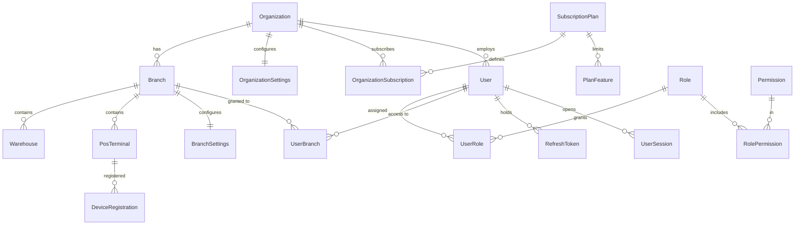
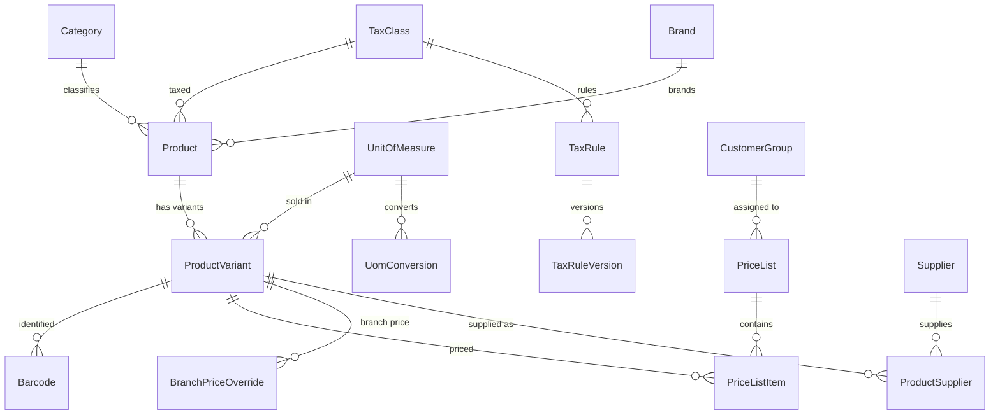
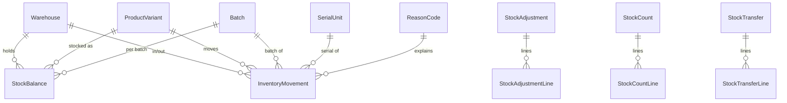
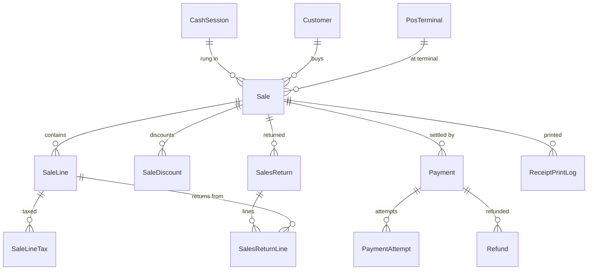

# 04 — Database Schema Design

RetailFlow POS · v0.1 · 2026-10-11 · target: **SQL Server** (provider-portable, ADR-0003)

This is the design that Phase 2+ migrations implement. Column lists show keys, money/quantity
precision and the columns that carry business meaning; routine descriptive fields are noted but not
all enumerated. Nothing here is created until its phase.

---

## 1. Conventions

| Topic | Convention |
|---|---|
| Table names | `PascalCase`, singular (`Sale`, `SaleLine`) |
| Primary key | `Id uniqueidentifier` (UUIDv7, ADR-0005), **non-clustered** on high-volume tables |
| Clustered index | Chosen per table for how it is written and read, never the GUID key — SQL Server sorts GUIDs by their last bytes, so a UUIDv7 key is random for clustering (ADR-0024) |
| Tenant column | `OrganizationId uniqueidentifier NOT NULL` on every tenant-owned table |
| Audit columns | `CreatedAtUtc datetime2(3)`, `CreatedByUserId`, `UpdatedAtUtc`, `UpdatedByUserId` |
| Soft delete | `IsDeleted bit`, `DeletedAtUtc`, `DeletedByUserId` — only where business requires recall |
| Concurrency | `ConcurrencyToken rowversion` (mapped behind a convention) |
| Sync | `ChangeSequence bigint NOT NULL` on syncable tables (ADR-0018) |
| Money | `decimal(19,4)`; quantity `decimal(18,3)`; unit cost `decimal(19,6)`; rate `decimal(9,6)` |
| Instants | `datetime2(3)` UTC, suffix `AtUtc`; business dates `date`, suffix `Date` |
| Enums | `tinyint`/`smallint` with a C# enum; values are append-only and documented |
| Unique keys | tenant-scoped: `(OrganizationId, …)` |
| Index names | `IX_<Table>_<Cols>`, unique `UX_`, FK `FK_<Child>_<Parent>` |
| Large text | declared unbounded, never as a provider type name, so it maps to `nvarchar(max)`, `text` or `longtext` (ADR-0003) |
| Delete behaviour | `NO ACTION` by default; `CASCADE` only from an aggregate root to its own lines |
| Cross-tenant guard | child FKs include `OrganizationId` in composite references where applicable |

Everything referencing a product on a transaction also stores **snapshots** (name, unit, price,
discount, tax rate/amount, unit cost), so catalog edits never rewrite history.

## 2. Module ownership map

| Module | Tables |
|---|---|
| Platform | `OutboxMessage`, `IdempotencyRecord`, `AuditLog`, `TenantChangeSequence`, `NumberSeries`, `NumberSeriesAllocation`, `BackgroundJobRun`, `SystemSetting` |
| Tenancy | `Organization`, `OrganizationSettings`, `Branch`, `BranchSettings`, `Warehouse`, `PosTerminal`, `SubscriptionPlan`, `PlanFeature`, `OrganizationSubscription` |
| Identity | `User`, `Role`, `Permission`, `RolePermission`, `UserRole`, `UserBranch`, `UserBranchPermission`, `RefreshToken`, `UserSession`, `LoginAttempt`, `DeviceRegistration`, `MfaSecret`, `PasswordResetToken` |
| Catalog | `Category`, `Brand`, `UnitOfMeasure`, `UomConversion`, `Product`, `ProductVariant`, `Barcode`, `ProductImage`, `ProductAttribute`, `ProductSupplier`, `ProductBranchSetting` |
| Pricing & Tax | `PriceList`, `PriceListItem`, `BranchPriceOverride`, `CustomerPrice`, `TaxClass`, `TaxRule`, `TaxRuleVersion`, `DiscountRule`, `Promotion`, `Coupon`, `CouponRedemption` |
| Inventory | `InventoryMovement`, `StockBalance`, `Batch`, `SerialUnit`, `StockReservation`, `StockAdjustment`, `StockAdjustmentLine`, `StockCount`, `StockCountLine`, `StockTransfer`, `StockTransferLine`, `ReasonCode` |
| Procurement | `Supplier`, `PurchaseOrder`, `PurchaseOrderLine`, `GoodsReceipt`, `GoodsReceiptLine`, `PurchaseInvoice`, `PurchaseInvoiceLine`, `PurchaseReturn`, `PurchaseReturnLine`, `SupplierPayment`, `SupplierLedgerEntry`, `LandedCostCharge` |
| Customers | `Customer`, `CustomerGroup`, `CustomerAddress`, `CreditAccount`, `CustomerLedgerEntry`, `CustomerPayment` |
| Loyalty | `LoyaltyProgram`, `LoyaltyAccount`, `LoyaltyTransaction` |
| Sales | `Sale`, `SaleLine`, `SaleLineTax`, `SaleDiscount`, `ParkedBill`, `PriceOverrideLog`, `ReceiptPrintLog`, `TerminalSequenceBlock` |
| Payments | `Payment`, `PaymentAttempt`, `PaymentProviderConfig`, `PaymentCallbackLog`, `Refund`, `PaymentReconciliationBatch`, `PaymentReconciliationItem` |
| Returns | `SalesReturn`, `SalesReturnLine`, `ReturnApproval` |
| Cash | `CashSession`, `CashMovement`, `CashCount`, `CashDenominationLine`, `Expense`, `ShiftAdjustment` |
| Sync | `SyncClientState`, `SyncOperationLog`, `SyncConflict` |
| Reporting | `DailySalesSummary`, `ProductDailySummary` (projections, Phase 16) |

## 3. Tenancy and identity

**Organization** — `Id`, `Code` (UX per platform), `Name`, `NameBn`, `LegalName`, `BinNumber`
(VAT BIN), `AddressLine`, `City`, `PhoneNumber`, `ContactEmail`, `CurrencyCode char(3)` default
`BDT`, `TimeZoneId` default `Asia/Dhaka`, `DefaultLanguage` (`en`/`bn`), `Status tinyint`
(Active/Suspended/Closed), `SuspendedAtUtc`, `SuspendedReason`, audit. Suspending, reactivating or
closing raises a domain event through the outbox. The trial lives on the subscription, not here.

**OrganizationSettings** — one row per org (UX `OrganizationId`, clustered). Every column is
**nullable**, and null means "inherit the platform default" (ADR-0031): `PriceIncludesTax`,
`AllowNegativeStock`, `RequireOpenShiftToSell`, `CashRoundingIncrement decimal(19,4)`,
`CashRoundingMode tinyint`, `MaxLineDiscountPercent decimal(9,6)`, `VoidWindowMinutes`,
`ReturnWindowDays`, `OfflineMaxDurationHours`, `OfflineMaxSaleAmount`,
`OfflineMaxCumulativeAmount`, `LoyaltyEnabled`, `CreditSalesEnabled`, `InvoiceNumberFormat`,
`ReceiptTemplate58`, `ReceiptTemplate80`, `ReceiptFooterText`.

> Two deliberate differences from the original sketch (ADR-0031). There is **no `CostingMethod`
> column**: ADR-0009 fixes moving weighted average platform-wide, and a one-value knob invites
> someone to change it. `AccessTokenMinutes`, `RefreshTokenDays` and `MfaRequiredForRoles` stay
> **platform-level** configuration in `appsettings`, because per-tenant token lifetimes need the
> token service to take them per tenant first, and a security setting that silently does nothing is
> worse than one that is clearly global.

**BranchSettings** — one row per branch (UX `(OrganizationId, BranchId)`, clustered), same nullable
columns as above **except** `InvoiceNumberFormat`, which is organization-wide so document numbers
stay comparable across branches (A-14).

**Branch** — `Id`, `OrganizationId`, `Code` (UX `(OrganizationId, Code)`, clustered), `Name`,
`NameBn`, address fields, `TimeZoneId`, `BusinessDayStart time`, `IsActive`, audit. The last active
branch of a tenant cannot be deactivated (A-15).
**Warehouse** — `Id`, `OrganizationId`, `BranchId`, `Code` (UX `(OrganizationId, Code)`), `Name`,
`Type tinyint` (Main/Sales/Damage/Transit), `IsDefault`, `IsActive`. Damage and Transit are real
warehouses so write-offs and transfers stay in the ledger, and neither may be a branch default.
A filtered unique index `(OrganizationId, BranchId) WHERE IsDefault = 1` means "the branch default"
can only ever name one row, and the default may not be deactivated (A-15).
**PosTerminal** — `Id`, `OrganizationId`, `BranchId`, `Code` (UX `(OrganizationId, Code)`), `Name`,
`DefaultWarehouseId` (no FK: it is a nullable override, and the handlers check it belongs to the
terminal's branch), `ReceiptTemplate58`, `ReceiptTemplate80`, `IsActive`, `LastSyncAtUtc`,
`AppVersion`, `DeviceFingerprint`. Receipt numbering is allocated per terminal by
`TerminalSequenceBlock` (Phase 9), so there is no `ReceiptSeriesId` column here.

**SubscriptionPlan** — platform reference data, not tenant-owned: `Id`, `Code` (UX, clustered),
`Name`, `Description`, `MonthlyPrice decimal(19,4)`, `CurrencyCode`, `TrialDays`, `SortOrder`,
`IsActive`. Seeded on start-up (FREE, STARTER, STANDARD, ENTERPRISE); the seeder adds what is
missing and never overwrites an existing row, because prices are a commercial decision whoever runs
the platform may change. No per-tenant change sequence: tills do not sync the price list.
**PlanFeature** — `Id`, `PlanId`, `Code tinyint` (Branches, Warehouses, PosTerminals, Users,
Products, OfflineMode, Loyalty, CreditSales, MultiWarehouse), `MaxCount int NULL` (null =
unlimited), `IsEnabled`. UX `(PlanId, Code)`. This is the table the original sketch called
`FeatureLimit`.
**OrganizationSubscription** — `Id`, `OrganizationId` (UX, clustered — one answer to "which plan is
this shop on"), `PlanId`, `Status tinyint` (Trialing/Active/PastDue/Expired/Cancelled),
`StartsOn date`, `CurrentPeriodEndsOn date`, `TrialEndsOn date NULL`, `GraceDays`,
`CancelledAtUtc`, `CancellationReason`, audit. Writes are allowed until
`CurrentPeriodEndsOn + GraceDays`; after that the tenant is read-only but still readable
(FR-TEN-06, ADR-0030).

**User** — `Id`, `OrganizationId` (nullable only for platform admins), `Email` (UX
`(OrganizationId, Email)`), `UserName`, `PhoneNumber`, `PasswordHash`, `PasswordHashVersion`,
`SecurityStamp`, `PermissionsVersion int`, `EmailConfirmed`, `IsActive`, `MustChangePassword`,
`AccessFailedCount`, `LockoutEndAtUtc`, `LastLoginAtUtc`, `PosPinHash` (fast cashier switch), audit.
**Role** — `Id`, `OrganizationId` (null = system template), `Name` (UX `(OrganizationId, Name)`),
`IsSystem`, `Description`.
**Permission** — `Id int`, `Code` (UX, e.g. `sales.void`), `Module`, `Description` — seeded from code.
**UserBranch** — `(UserId, BranchId)` UX, `IsDefault`, optional `RoleId` override.
**UserBranchPermission** — per-branch grant/deny of a specific permission with a reason.
**RefreshToken** — `Id`, `UserId`, `TokenHash binary(32)` (UX), `FamilyId`, `ParentTokenId`,
`ExpiresAtUtc`, `ConsumedAtUtc`, `RevokedAtUtc`, `RevokedReason`, `CreatedByIp`, `DeviceId`.
**UserSession** — `Id`, `UserId`, `DeviceId`, `TerminalId?`, `StartedAtUtc`, `LastSeenAtUtc`,
`EndedAtUtc`, `Ip`, `UserAgent`.
**LoginAttempt** — `Id`, `OrganizationId?`, `UserId?`, `EmailAttempted`, `Succeeded`, `FailureReason`,
`Ip`, `DeviceId`, `AtUtc`. Index `(OrganizationId, AtUtc)` and `(Ip, AtUtc)` for rate limiting.
**DeviceRegistration** — `Id`, `OrganizationId`, `TerminalId`, `DeviceSecretHash`, `Name`,
`RegisteredAtUtc`, `RevokedAtUtc`, `LastSeenAtUtc`.

## 4. Catalog, pricing and tax

**Product** — `Id`, `OrganizationId`, `Code` (UX), `Name`, `NameBn`, `CategoryId`, `BrandId`,
`TaxClassId`, `ProductType` (Standard/Service/Composite-reserved), `TrackInventory bit`,
`TrackBatch bit`, `TrackSerial bit`, `TrackExpiry bit`, `BaseUomId`, `Status tinyint`
(Draft/Active/Inactive/Archived), `Description`, `IsDeleted`, `ChangeSequence`, audit.
**ProductVariant** — `Id`, `OrganizationId`, `ProductId`, `Sku` (UX `(OrganizationId, Sku)`),
`Name`, `AttributesJson`, `BasePrice decimal(19,4)`, `LastPurchaseCost decimal(19,6)`,
`UomId`, `PackSize decimal(18,3)`, `Weight`, `IsDefault`, `Status`, `ChangeSequence`.
**Barcode** — `Id`, `OrganizationId`, `ProductVariantId`, `Code` (UX `(OrganizationId, Code)`),
`Type` (EAN13/UPC/Code128/Internal/WeightEmbedded), `IsPrimary`, `PackQuantity decimal(18,3)` —
a case barcode can sell 24 pieces in one scan.
**UomConversion** — `(OrganizationId, FromUomId, ToUomId)` UX, `Factor decimal(18,6)`.
**ProductBranchSetting** — per branch: `MinStock`, `ReorderLevel`, `ReorderQuantity`, `IsSellable`.
**TaxClass** — `Id`, `OrganizationId`, `Code`, `Name`, `IsExempt`, `IsZeroRated`.
**TaxRule / TaxRuleVersion** — rule per `(TaxClassId, BranchId?)`; version holds
`Version int`, `VatRate decimal(9,6)`, `SdRate decimal(9,6)`, `SdInVatBase bit`,
`PriceIncludesTax bit`, `EffectiveFromUtc`, `EffectiveToUtc`, `SroReference`, `Notes`.
UX `(TaxRuleId, Version)`; a filtered index enforces one open-ended current version per rule.
**PriceList** — `Id`, `OrganizationId`, `Code`, `Name`, `CustomerGroupId?`, `BranchId?`,
`Priority int`, `EffectiveFromUtc`, `EffectiveToUtc`, `Version`, `IsActive`.
**PriceListItem** — `(PriceListId, ProductVariantId)` UX, `UnitPrice decimal(19,4)`,
`MinQuantity decimal(18,3)` (tiered/wholesale pricing).
**DiscountRule** — scope (variant/category/customer group/branch), `Kind` (Percent/Amount),
`Value`, `MaxAmount`, `RequiresPermission`, effective window, `Priority`, `Stackable`.
**Coupon** — `Code` (UX per org), `Kind`, `Value`, `MinBasket`, `UsageLimitTotal`,
`UsageLimitPerCustomer`, window, `IsActive`; **CouponRedemption** — `(CouponId, SaleId)` UX.

## 5. Inventory

**InventoryMovement** (append-only, the ledger) —
`Id`, `OrganizationId`, `BranchId`, `WarehouseId`, `ProductVariantId`, `BatchId?`, `SerialUnitId?`,
`MovementType tinyint` (Opening, PurchaseReceipt, Sale, SalesReturn, PurchaseReturn, TransferOut,
TransferIn, Adjustment, AdjustmentReversal, Damage, ExpiryWriteOff, CountCorrection,
ProductionIn-reserved), `Direction smallint` (+1/−1), `Quantity decimal(18,3)` (always positive),
`UnitCost decimal(19,6)`, `TotalCost decimal(19,4)`, `BalanceAfter decimal(18,3)` (ledger
readability), `AverageCostAfter decimal(19,6)`, `DocumentType tinyint`, `DocumentId`,
`DocumentLineId?`, `DocumentNumber`, `ReasonCodeId?`, `Notes`, `ReversesMovementId?`,
`BusinessDate date`, `OccurredAtUtc`, `CreatedByUserId`, `TerminalId?`, `ChangeSequence`.
Indexes: `(OrganizationId, WarehouseId, ProductVariantId, OccurredAtUtc)`,
`(OrganizationId, DocumentType, DocumentId)`, `(OrganizationId, BusinessDate)`,
`(OrganizationId, ChangeSequence)`.
Guard: no UPDATE/DELETE — enforced by the repository plus (Phase 2) an `INSTEAD OF` trigger-free
convention test; corrections use `AdjustmentReversal`.

**StockBalance** (projection) — UX `(OrganizationId, WarehouseId, ProductVariantId, BatchId)` with a
sentinel empty GUID for non-batch rows, `QuantityOnHand`, `QuantityReserved`, `QuantityInTransit`,
`AverageUnitCost decimal(19,6)`, `LastMovementAtUtc`, `ConcurrencyToken`, `ChangeSequence`.
Computed-at-read `Available = QuantityOnHand - QuantityReserved`.
Index `(OrganizationId, ProductVariantId)` for cross-warehouse lookups; filtered index on
`QuantityOnHand <= 0` for exception reports.

**Batch** — `Id`, `OrganizationId`, `ProductVariantId`, `BatchNumber` (UX per variant),
`ManufactureDate`, `ExpiryDate`, `ReceivedUnitCost`, `SupplierId?`, `IsBlocked`.
**SerialUnit** — `Id`, `OrganizationId`, `ProductVariantId`, `SerialNumber` (UX per org),
`Status tinyint` (InStock/Sold/Returned/Damaged/Transferred), `WarehouseId?`, `BatchId?`,
`UnitCost`, `SaleLineId?`, `WarrantyMonths`.
**StockReservation** — `Id`, scope keys, `Quantity`, `Reason` (ParkedBill/Transfer/Order),
`DocumentId`, `ExpiresAtUtc` — a cleanup job releases expired reservations.
**StockAdjustment** — header with `Status` (Draft/PendingApproval/Approved/Posted/Rejected),
`ReasonCodeId`, `TotalCostImpact`, approver fields; lines with expected/actual/difference.
**StockCount** — `Status` (Draft/Counting/Review/Approved/Posted/Cancelled), `SnapshotAtUtc`,
`WarehouseId`, `IsBlind`, scope filter; **StockCountLine** — `ExpectedQuantity`, `CountedQuantity`,
`PostSnapshotMovementQuantity`, `VarianceQuantity`, `VarianceValue`, `Recounted bit`.
**StockTransfer** — `Status` (Draft/Dispatched/InTransit/PartiallyReceived/Received/Cancelled),
source/destination warehouse, dispatch/receipt users and timestamps, `TransferNumber` (UX);
**StockTransferLine** — `QuantityDispatched`, `QuantityReceived`, `QuantityShortage`,
`UnitCostAtDispatch`, `DiscrepancyReasonCodeId?`.

## 6. Procurement

**PurchaseOrder** — `Id`, `OrganizationId`, `BranchId`, `SupplierId`, `OrderNumber` (UX),
`Status tinyint` (Draft/PendingApproval/Approved/Sent/PartiallyReceived/Received/Closed/Cancelled),
`OrderDate`, `ExpectedDate`, `CurrencyCode`, `SubTotal`, `DiscountTotal`, `TaxTotal`, `GrandTotal`,
`ApprovedByUserId?`, `ApprovedAtUtc?`, `Notes`, audit, `ChangeSequence`.
**PurchaseOrderLine** — `ProductVariantId`, snapshots (`ProductName`, `Uom`), `Quantity`,
`UnitCost decimal(19,6)`, `DiscountAmount`, `TaxRate`, `TaxAmount`, `LineTotal`,
`QuantityReceived`, `QuantityInvoiced`, `ExpectedDate`.
**GoodsReceipt** — `ReceiptNumber` (UX), `PurchaseOrderId?`, `SupplierId`, `WarehouseId`,
`Status` (Draft/Accepted/Cancelled), `ReceivedAtUtc`, `SupplierReference`, `Notes`,
`LandedCostTotal`. Stock posts **only** on `Accepted` (FR-PUR-03).
**GoodsReceiptLine** — `PurchaseOrderLineId?`, `ProductVariantId`, `QuantityOrdered`,
`QuantityReceived`, `QuantityAccepted`, `QuantityRejected`, `RejectReasonCodeId?`, `UnitCost`,
`AllocatedLandedCost`, `FinalUnitCost` (feeds average cost), `BatchId?`, `SerialNumbersJson?`,
`ExpiryDate?`.
**LandedCostCharge** — `GoodsReceiptId`, `ChargeType` (Freight/Duty/Clearing/Other), `Amount`,
`AllocationBasis`, `SupplierId?`.
**PurchaseInvoice / Line** — `InvoiceNumber` (supplier's, UX per supplier), links to PO and receipt
lines, matched quantities and amounts, `MatchStatus` (Unmatched/Matched/Variance), `DueDate`,
`Status` (Open/PartiallyPaid/Paid/Disputed/Cancelled).
**PurchaseReturn / Line** — reverses receipt lines at the receipt's cost, `Status`, `ReasonCodeId`,
credit note reference.
**SupplierPayment** — `SupplierId`, `Amount`, `Method`, `Reference`, `PaidAtUtc`, allocations to
invoices (`SupplierPaymentAllocation`), `CashSessionId?` when paid from the till.
**SupplierLedgerEntry** — invoice/payment/return/adjustment entries; balance = sum (never edited).

## 7. Customers, credit and loyalty

**Customer** — `Id`, `OrganizationId`, `Code` (UX), `Name`, `PhoneNumber` (UX
`(OrganizationId, PhoneNumber)` filtered on non-null), `Email`, `CustomerGroupId?`, `TaxId`,
`BranchId?` (home branch), `IsWalkIn bit`, `IsActive`, `ChangeSequence`, audit.
**CreditAccount** — one per customer: `CreditLimit decimal(19,4)`, `OutstandingBalance` (projection of
the ledger), `OverdueAmount`, `PaymentTermDays`, `IsActive`, `BlockedReason`, `ConcurrencyToken`.
**CustomerLedgerEntry** — `EntryType` (SaleInvoice/Payment/ReturnCredit/Adjustment/WriteOff/
OpeningBalance), `Amount` signed, `DocumentType/DocumentId/DocumentNumber`, `DueDate`,
`BalanceAfter`, `BusinessDate`, `OccurredAtUtc`. Append-only.
**CustomerPayment** — `Amount`, `Method`, `Reference`, `ReceiptNumber` (UX), `CashSessionId?`,
allocations (`CustomerPaymentAllocation` → invoice entries), `ReceivedByUserId`.
**LoyaltyProgram** — `PointsPerCurrencyUnit`, `CurrencyPerPoint`, `MinBasketAmount`,
`MaxRedemptionPercent`, `RedemptionStep`, `ExpiryMonths`, `ExcludeDiscountedItems`,
`ExcludedCategoryIdsJson`, window, `IsActive`.
**LoyaltyAccount** — per `(ProgramId, CustomerId)` UX: `PointsBalance decimal(18,3)`,
`LifetimeEarned`, `LifetimeRedeemed`, `ConcurrencyToken`.
**LoyaltyTransaction** — `Type` (Accrual/Redemption/Expiry/Adjustment/ReturnReversal),
`Points` signed, `SaleId?`, `SalesReturnId?`, `ExpiresOn date?`, `BalanceAfter`,
UX `(ProgramId, SaleId, Type)` — the structural guarantee against double accrual (FR-CUS-06).

## 8. Sales, payments, returns

**Sale** — `Id` (client-generatable, ADR-0005), `OrganizationId`, `BranchId`, `WarehouseId`,
`TerminalId`, `CashSessionId`, `CashierUserId`, `CustomerId?`, `SaleNumber` (UX
`(OrganizationId, SaleNumber)`), `NumberSeriesId`, `Status tinyint`
(Draft/Completed/Voided/PartiallyReturned/Returned), `SyncStatus tinyint`
(ServerCreated/LocallyAccepted/ServerConfirmed), `Channel` (Pos/Web/Offline),
`SubTotal`, `TotalLineDiscount`, `BillDiscount`, `TotalDiscount`, `TaxableValue`, `TotalVat`,
`TotalSd`, `GrandTotal`, `CashRoundingAdjustment`, `AmountPayable`, `AmountPaid`, `ChangeGiven`,
`BalanceDue`, `CurrencyCode`, `TotalCost` (COGS snapshot), `TaxConfigVersion`, `PriceListVersion`,
`BusinessDate date`, `OccurredAtUtc` (business time), `DeviceCreatedAtUtc?`, `ServerReceivedAtUtc?`,
`ClockSkewSeconds?`, `LocalSaleId?` + UX `(OrganizationId, TerminalId, LocalSaleId)`,
`IdempotencyKey`, `Flags` (CreditExceeded, PriceVariance, StaleTaxConfig, ClockSkew),
`VoidedBySaleId?`, `VoidReason`, `Notes`, `ConcurrencyToken`, `ChangeSequence`, audit.
Indexes: `(OrganizationId, BranchId, BusinessDate)`, `(OrganizationId, CustomerId, OccurredAtUtc)`,
`(OrganizationId, CashSessionId)`, `(OrganizationId, ChangeSequence)`, `(OrganizationId, SaleNumber)`.

**SaleLine** — `Id`, `SaleId`, `OrganizationId`, `LineNumber`, `ProductVariantId`, `BatchId?`,
`SerialUnitId?`, snapshots: `ProductName`, `ProductNameBn`, `Sku`, `Barcode`, `UomCode`,
`Quantity decimal(18,3)`, `UnitPrice decimal(19,4)`, `OriginalUnitPrice`, `PriceSource tinyint`,
`LineDiscountAmount`, `AllocatedBillDiscount`, `NetAmount`, `SdAmount`, `VatAmount`, `LineTotal`,
`TaxRuleVersionId`, `VatRate`, `SdRate`, `UnitCostSnapshot decimal(19,6)`, `TotalCost`,
`QuantityReturned decimal(18,3)`, `IsPriceOverridden`, `OverrideApprovedByUserId?`, `Note`.
UX `(SaleId, LineNumber)`.
**SaleLineTax** — one row per tax component (VAT, SD) for filings: `Component`, `Rate`, `BaseAmount`,
`TaxAmount`, `TaxRuleVersionId`.
**SaleDiscount** — bill-level discounts/coupons: `Kind`, `Value`, `Amount`, `CouponId?`,
`DiscountRuleId?`, `ApprovedByUserId?`, `Reason`.
**ParkedBill** — `TerminalId`, `CashierUserId`, `CustomerId?`, `Label`, `PayloadJson` (cart
snapshot), `ReservedStock bit`, `ParkedAtUtc`, `ExpiresAtUtc`, `RecalledAtUtc?`.
**PriceOverrideLog** / **ReceiptPrintLog** — who, when, old/new, reason, copy number, printer id.
**TerminalSequenceBlock** — `TerminalId`, `NumberSeriesId`, `RangeStart`, `RangeEnd`, `NextValue`,
`IssuedAtUtc`, `ExhaustedAtUtc?` — offline numbering (ADR-0017), UX
`(OrganizationId, NumberSeriesId, RangeStart)`.

**Payment** — `Id`, `OrganizationId`, `SaleId?`, `SalesReturnId?`, `CustomerPaymentId?`,
`Method tinyint` (Cash/Card/Bkash/Nagad/BankTransfer/CustomerCredit/LoyaltyPoints/Other),
`Status tinyint` (Pending/Authorized/Completed/Failed/Reversed/RefundPending/Refunded/UnknownOutcome),
`Amount`, `TenderedAmount?`, `ChangeAmount?`, `CurrencyCode`, `ProviderId?`,
`ProviderReference?` + UX `(ProviderId, ProviderReference)` filtered on non-null,
`ProviderPaymentToken?`, `CardLast4?`, `CardBrand?`, `AuthorizedAtUtc?`, `CompletedAtUtc?`,
`FailureCode?`, `FailureMessage?`, `IdempotencyKey`, `CashSessionId?`, `ReconciledAtUtc?`,
`ReconciliationBatchId?`, `ConcurrencyToken`, `ChangeSequence`.
**PaymentAttempt** — every provider round trip: request/response hashes (never raw card data),
`HttpStatus`, `Outcome`, `DurationMs`, `AtUtc`.
**PaymentCallbackLog** — raw signed payload (redacted), signature check result, processing result,
`ProviderReference`, UX on `(ProviderId, SignatureHash)` to kill replays.
**PaymentProviderConfig** — per org/branch: provider, mode (sandbox/live), merchant id, secret
reference (**a key-vault reference, never the secret**), `IsEnabled`, `OfflineSupported bit` (false
for bKash/Nagad today).
**Refund** — `PaymentId`, `SalesReturnId`, `Amount`, `Status`, `ProviderRefundReference`,
`RequestedByUserId`, `ApprovedByUserId`, timestamps.
**PaymentReconciliationBatch/Item** — imported settlement file, matched/unmatched items with
difference and resolution state.

**SalesReturn** — `Id`, `OrganizationId`, `BranchId`, `WarehouseId`, `TerminalId`, `CashSessionId?`,
`OriginalSaleId?`, `ReturnNumber` (UX), `Status` (Draft/Approved/Completed/Rejected),
`ReasonCodeId`, `IsBlindReturn`, `RefundMethod`, `SubTotal`, `TotalVat`, `TotalSd`,
`RefundAmount`, `RestockValue`, `DamageValue`, `LoyaltyPointsReversed`, `ApprovedByUserId?`,
`ExchangeSaleId?`, `BusinessDate`, `OccurredAtUtc`, `LocalReturnId?`, `IdempotencyKey`,
`ChangeSequence`.
**SalesReturnLine** — `OriginalSaleLineId?`, `ProductVariantId`, `BatchId?`, `SerialUnitId?`,
`Quantity`, `UnitPriceSnapshot`, `DiscountShare`, `VatShare`, `SdShare`, `RefundAmount`,
`UnitCostSnapshot`, `Condition tinyint` (Good/Opened/Damaged/Expired), `RestockedQuantity`,
`DamagedQuantity`, `ReasonCodeId?`.
**ReturnApproval** — approver, level, amount, reason, `AtUtc` (also used for over-refund exceptions).

## 9. Cash and shifts

**CashSession** — `Id`, `OrganizationId`, `BranchId`, `TerminalId`, `CashierUserId`,
`SessionNumber` (UX), `Status` (Open/PendingClose/Closed), `OpenedAtUtc`, `ClosedAtUtc?`,
`OpeningFloat`, `CashSalesTotal`, `CashRefundsTotal`, `CashInTotal`, `CashOutTotal`,
`ExpenseTotal`, `ExpectedCash`, `CountedCash`, `Variance`, `NonCashTotalsJson` (per method
snapshot), `VarianceApprovedByUserId?`, `VarianceReason`, `BusinessDate`, `ConcurrencyToken`,
`ChangeSequence`. Filtered UX: one `Open` session per `(OrganizationId, TerminalId)`.
**CashMovement** — `CashSessionId`, `Type` (OpeningFloat/CashSale/CashRefund/CashIn/CashOut/
Expense/SupplierPayment/CustomerCollection/SafeDrop), `Amount` signed, `DocumentType/DocumentId`,
`ReasonCodeId?`, `Notes`, `OccurredAtUtc`, `CreatedByUserId`. Append-only.
**CashCount / CashDenominationLine** — count event with per-denomination quantities (1, 2, 5, 10,
20, 50, 100, 200, 500, 1000 BDT), `CountedTotal`, `CountedByUserId`, `WitnessUserId?`.
**Expense** — `BranchId`, `CategoryId`, `Amount`, `PaidFrom` (Till/Bank), `CashSessionId?`,
`Payee`, `Reference`, `AttachmentUrl?`, `ApprovedByUserId?`.
**ShiftAdjustment** — post-close correction: `CashSessionId`, `Amount`, `Reason`,
`ApprovedByUserId`, `AtUtc`, `AuditLogId` — the only legal way to touch a closed shift (FR-CSH-05).

## 10. Platform tables

**OutboxMessage** — `Id`, `OrganizationId?`, `MessageType`, `PayloadJson`, `Status tinyint`
(Pending/Processing/Processed/Failed/DeadLettered), `AttemptCount`, `NextAttemptAtUtc`,
`LeaseOwner`, `LeaseExpiresAtUtc`, `LastError`, `CorrelationId`, `CreatedAtUtc`, `ProcessedAtUtc`.
Index `(Status, NextAttemptAtUtc)` filtered on Pending/Failed — the dispatcher's hot path.
**IdempotencyRecord** — UX `(OrganizationId, Key)`, `Endpoint`, `RequestHash binary(32)`,
`Status` (InProgress/Completed/Failed), `HttpStatusCode`, `ResponseJson`, `ResourceId?`,
`CreatedAtUtc`, `CompletedAtUtc`, `ExpiresAtUtc`. Index on `ExpiresAtUtc` for the purge job.
**AuditLog** — `Id`, `OrganizationId?`, `UserId?`, `Action`, `EntityType`, `EntityId`,
`BranchId?`, `TerminalId?`, `BeforeJson`, `AfterJson`, `Metadata`, `CorrelationId`, `Ip`,
`UserAgent`, `AtUtc`. Indexes `(OrganizationId, AtUtc)`, `(OrganizationId, EntityType, EntityId)`.
**TenantChangeSequence** — `OrganizationId` PK, `LastSequence bigint`, `ConcurrencyToken` — the
monotonic allocator for `ChangeSequence` (ADR-0018).
**NumberSeries** — `(OrganizationId, DocumentType, BranchId?, Code)` UX, `Prefix`, `Suffix`,
`Padding`, `ResetPeriod`, `CurrentPeriodKey`, `NextValue`, `BlockSizeForTerminals`,
`ConcurrencyToken`; **NumberSeriesAllocation** — audit of issued ranges/numbers.
**SyncClientState** — `(OrganizationId, TerminalId)` UX, `LastPulledSequence`,
`LastPushAtUtc`, `LastPullAtUtc`, `AppVersion`, `LocalDbVersion`, `PendingOperationCount`,
`OfflineSinceUtc?`, `CumulativeOfflineAmount`.
**SyncOperationLog** — `(OrganizationId, TerminalId, OperationId)` UX, `OperationType`,
`Result` (Applied/Duplicate/Conflict/Rejected), `ErrorCode`, `ReceivedAtUtc`, `ProcessedAtUtc`,
`ServerDocumentId?`.
**SyncConflict** — the record, reason code, payload, `Status` (Open/Resolved/Discarded),
resolver, resolution note.
**ReasonCode** — `(OrganizationId, Scope, Code)` UX for adjustments, returns, voids, variances,
transfers; `RequiresApproval bit`, `RequiresNote bit`.

## 11. Indexing and performance plan

Hot paths and their indexes (validated by load test in Phase 17):

| Query | Index |
|---|---|
| Barcode scan | `UX_Barcode_Org_Code (OrganizationId, Code)` — covering `ProductVariantId, PackQuantity` |
| Product search by name/SKU | `IX_ProductVariant_Org_Sku`, `IX_Product_Org_Name` (+ optional full-text later) |
| Stock check at checkout | `UX_StockBalance_Org_Wh_Variant_Batch` (clustered on this key) |
| Sale list / day close | `IX_Sale_Org_Branch_BusinessDate` include totals |
| Sync pull | `IX_<table>_Org_ChangeSequence` on every syncable table |
| Outbox dispatch | filtered `IX_OutboxMessage_Status_NextAttempt` |
| Ledger report | `IX_InventoryMovement_Org_Wh_Variant_OccurredAt` |
| Customer due | `IX_CustomerLedgerEntry_Org_Customer_DueDate` |
| Audit search | `IX_AuditLog_Org_AtUtc`, `IX_AuditLog_Org_Entity` |

- `AsNoTracking` + explicit projections for all reads; `Include` only inside aggregate loads.
- No lazy loading anywhere (disabled), to make N+1 impossible by construction.
- Detail reports paginate; summary reports use `DailySalesSummary`/`ProductDailySummary`
  projections refreshed by the outbox consumer and rebuildable from the ledger.
- High-volume tables (`InventoryMovement`, `AuditLog`, `Sale`, `SaleLine`, `OutboxMessage`,
  `LoginAttempt`) get a monthly archival strategy (Phase 17): move rows older than the retention
  window to `*_Archive` tables; `OutboxMessage`/`IdempotencyRecord`/`LoginAttempt` are purged.

## 12. Retention and deletion

| Data | Retention | Mechanism |
|---|---|---|
| Sales, returns, payments, inventory movements, cash sessions | ≥ 6 years (tax) | never deleted; archived after 24 months |
| Audit log | ≥ 6 years | archived after 12 months |
| Idempotency records | 90 days | purge job |
| Sync operation log | 180 days | purge job |
| Outbox processed messages | 30 days | purge job |
| Login attempts | 12 months | purge job |
| Products, customers, suppliers | life of tenant | archive/soft delete, never hard delete once referenced |
| Deleted tenant | 30-day grace, then export + purge | documented procedure, Phase 18 |

## 13. Migration policy

- One EF migration per logical change, named `YYYYMMDDHHMM_<Verb><Subject>`; never edit an applied
  migration — add a new one.
- Every migration is reviewed as SQL (`dotnet ef migrations script`) before any shared environment.
- Destructive steps (drop/rename/narrow) are split into expand → backfill → contract across
  releases so a rollback never loses data.
- `__EFMigrationsHistory` is the source of truth; the API validates at startup that the database is
  at or ahead of the model's expected migration and refuses to start otherwise.
- A migration test (Phase 2) applies every migration from empty to head on a throwaway database in
  CI, and a seed test proves the dev seed loads on a fresh database.
