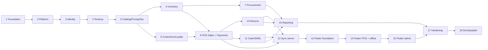

# 05 — Implementation Roadmap

RetailFlow POS · v0.1 · 2026-10-11 · live status lives in `../tasks.md`

---

## 1. Principles

- **Vertical slices.** Each item ships domain → persistence → use case → API → tests → docs. No
  phase ends with an endpoint that has no test or a screen with no backend.
- **Runnable at every step.** `dotnet build`, `dotnet test` and (from Phase 13) `flutter test` must
  be green at the end of every phase.
- **Backend before client.** Phases 2–12 harden the money and stock rules on the server; the Flutter
  app (13–15) then consumes contracts that already have tests.
- **Correctness-first ordering.** Inventory and idempotency land before POS, because a fast checkout
  on a wrong ledger is worthless.
- **Nothing faked.** Where an external prerequisite is missing (bKash credentials, a thermal
  printer), the adapter and its test double ship, and the gap is listed in `tasks.md` as blocked.

## 2. Phase dependency graph

Parallelisable once Phase 5 is done: 7 (procurement) and 8 (customers/loyalty) are independent;
15 (admin screens) can proceed alongside 16 (reporting).

## 3. Phase exit criteria

| Phase | Done when |
|---|---|
| 1 Foundation | Docs, ADRs, checklist exist; solution builds; toolchain and DB target confirmed |
| 2 Platform | Migration applied to localhost SQL Server; tenancy filter, audit, outbox, idempotency proven by integration tests; health endpoints and ProblemDetails live; dev seed loads |
| 3 Identity | Login/refresh/logout work end to end; refresh reuse revokes the family; permission + branch checks enforced; lockout and rate limits tested; cross-tenant access test red→green |
| 4 Tenancy | **Met 2026-10-12.** Provisioning creates a working branch/warehouse/terminal/roles/owner in one transaction and the owner signs in; settings precedence, plan limits and the read-only gate for a suspended or lapsed tenant tested |
| 5 Catalog | Product/variant/barcode CRUD, price resolution and tax engine tested against the formulas in `02-business-rules.md`; CSV import with a validation report |
| 6 Inventory | All movement types post; balances match a ledger re-sum; concurrent last-unit test proves no oversell; transfers and counts complete with approvals |
| 7 Procurement | PO → GRN → invoice → payment path tested including partial receipt, three-way match and landed cost into average cost |
| 8 Customers | Credit limit enforcement, ledger-derived balances, loyalty accrual/redemption/reversal with duplicate prevention tested |
| 9 POS Sales | `POST /sales` implements the 9-step workflow in one transaction; split tender, cash rounding, idempotent retry, unknown-outcome recovery, void and reprint audit all tested; receipt renders 58/80 mm |
| 10 Returns | Partial and repeat returns, over-return rejection, refund caps, restock vs damage, loyalty reversal, provider refund reference tested |
| 11 Cash | Shift open/close with the expected-cash formula, variance approval, closed-shift immutability, Z-report |
| 12 Sync | Push/pull/status endpoints with per-operation results; lost-ack replay returns the original sale; resumable pull; conflicts recorded and resolvable |
| 13 Flutter base | App runs on Windows and Android; login + token refresh; Drift schema + migrations; outbox and sync engine unit-tested |
| 14 Flutter POS | A complete sale on a desktop keyboard-only flow and on a tablet; airplane-mode sale commits locally and syncs on reconnect against the real API |
| 15 Flutter admin | Catalog, inventory, procurement, customers, cash and settings screens on real endpoints with validation and error states |
| 16 Reporting | Every FR-REP report returns correct numbers against fixture data, with tenant/branch/date filters and export |
| 17 Hardening | E2E suite green; architecture and authorization regression tests green; load test numbers recorded (replacing the provisional NFR-03 targets); security scan clean; observability dashboards live |
| 18 DevOps | One-command local bring-up; CI green on build/format/test/migration; backup taken and **restored** in a drill; runbooks reviewed |

## 4. Pilot readiness gate

Before the first production pilot (spec §25), all of these must be demonstrated on real hardware
with real users:

1. 100 consecutive sales with correct totals, tax and stock movement.
2. Two terminals selling the last unit concurrently — exactly one succeeds.
3. A sale completed offline for 2 hours, then synced — exactly one sale on the server.
4. A pulled network cable mid-payment — no duplicate charge, state resolves to a definite outcome.
5. A partial return with proportional tax and loyalty reversal, refunded and reconciled.
6. A shift closed with a deliberate variance, approved by a supervisor, immutable afterwards.
7. A cross-tenant access attempt (manipulated IDs and token) — denied and audited.
8. A database restore from backup into a clean instance with no data loss beyond the RPO.
9. VAT/SD configuration signed off by the customer's accountant (open question O-1/O-2).

## 5. Risk register

| Risk | Likelihood | Impact | Mitigation |
|---|---|---|---|
| VAT/SD rules modelled incorrectly | Medium | High (legal) | Configurable, versioned engine; accountant sign-off gate; snapshots per line |
| Offline stock drift during long outages | Medium | Medium | Offline duration/value limits; server re-validation; exception reports |
| Duplicate charges on flaky networks | Medium | High | Idempotency keys, provider reference uniqueness, UnknownOutcome state, reconciliation |
| MFS provider credentials delayed | High | Medium | Adapters + test doubles now; cash/card path independent of them |
| Bangla thermal printing quality varies by model | High | Low–Medium | Raster rendering fallback; per-model profiles; verify on pilot hardware |
| Deadlocks under concurrent checkout | Medium | Medium | Canonical lock ordering, short transactions, retry with jitter, load test |
| Report queries slow on large tenants | Medium | Medium | Projections, keyset pagination, index plan, measured in Phase 17 |
| Scope creep into accounting/e-commerce | Medium | Medium | Explicit out-of-scope list in `01-requirements.md` §1 |

## 6. Phase 5 entry checklist (next session)

Phases 1–4 are complete: the platform, identity and tenancy foundations are in place, so the
catalog has a tenant, a branch, a warehouse and a terminal to hang from.

1. `cd backend && dotnet build && dotnet test` — expect green (see `tasks.md` for the current count).
2. Catalog entities in Domain: `Category`, `Brand`, `UnitOfMeasure`, `UomConversion`, `Product`,
   `ProductVariant`, `Barcode` — variant/SKU/barcode rules first, archival instead of delete.
3. Pricing and tax: `TaxClass`, `TaxRule`, `TaxRuleVersion`, `PriceList`, `PriceListItem`,
   `BranchPriceOverride`, `DiscountRule`, with the price-resolution service and the tax engine
   written against the formulas in `02-business-rules.md` §1–2 (A-02 is still an open question, so
   the engine stays configurable and nothing is hard-coded).
4. Settings already resolve through the chain, so the catalog reads `PriceIncludesTax` and
   `MaxLineDiscountPercent` from `IEffectiveSettingsProvider` rather than inventing its own.
5. Wire the `Products` plan limit into `IPlanLimitGuard` — the feature code exists and is reported
   as uncounted until the catalog can count it.
6. Tests: price resolution precedence, inclusive/exclusive tax math, SD stacking, rounding, barcode
   uniqueness per tenant, CSV import validation report.
